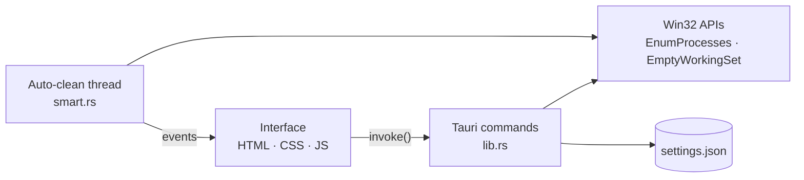

<div align="center">


# RAM Cleaner

**Free up RAM on Windows in one click, or let it do it for you from the tray.**

A small, fast memory cleaner built with Rust and Tauri 2. Live gauge, real app icons,
and protection for the apps you never want touched.

[](https://github.com/Raldexx/ram-cleaner/releases/latest)
[](https://github.com/Raldexx/ram-cleaner/releases)


[Download](#download) ·
[Features](#features) ·
[How it works](#how-it-works) ·
[Settings](#settings) ·
[Build from source](#build-from-source) ·
[FAQ](#faq)

</div>

<!--
  Add a screenshot: save it as docs/screenshot.png, then remove the comment markers
  around the image line below so it shows up.

  
-->

---

## Download

1. Open the [latest release](https://github.com/Raldexx/ram-cleaner/releases/latest).
2. Download the `RAM.Cleaner_x.y.z_x64-setup.exe` installer and run it.
3. If Windows SmartScreen says *"Windows protected your PC"*, click **More info**, then **Run anyway**.
   The installer is not code signed yet, so Windows shows this for every new unsigned app.

Requires Windows 10 or 11 (64-bit). The WebView2 runtime is included in Windows 11; on Windows 10 the
installer downloads it if it is missing.

---

## Features

**See what is using your memory**

- Large live RAM gauge with used, available and total memory. It turns orange at 80% and red at 90%.
- Running apps grouped by name, so 12 Chrome processes show up as one row with their combined memory.
- Real app icons, friendly names (`msedge.exe` becomes *Microsoft Edge*) and a memory bar per app.
- Need the details? Click a row to expand it and see every process ID with its own memory and a Clean button.
- Fuzzy search by name or process ID: typing `chm` finds Chrome.
- Sort by memory or name.

**Clean what you want, leave the rest**

- Clean everything with one button, a single app, or a single process.
- **Whitelist:** apps that are never cleaned.
- **Blacklist:** switch the clean mode to *Blacklist only* and just those apps are cleaned.
- **Critical apps:** while a game or editor from this list is running, cleaning pauses and asks first.
- Typeahead suggestions and one-click quick add for the apps using the most memory.

**Runs quietly in the background**

- Auto clean on a schedule (every N minutes) or whenever RAM usage passes a threshold.
- Closing the window keeps it running in the system tray. Left-click the tray icon to bring it back.
- Optional start with Windows, minimized straight to the tray.
- While the window is hidden, the interface stops all timers and animations.

**Looks at home on Windows**

- Follows the Windows accent color.
- Light and dark themes: Auto (follows Windows), Light or Dark from the button in the top bar.
- First-run welcome tour that sets up auto clean and startup.

---

## How it works



A clean runs these steps:

1. List all running processes and read their memory use.
2. If a **critical app** is running, stop and ask for confirmation.
3. Apply the **whitelist** and **blacklist** to decide which processes to touch.
4. Call `EmptyWorkingSet` on each of them. This asks Windows to move their idle memory pages out of the
   app's working set.
5. Report how much available memory grew.

### What cleaning does, and what it does not

| It does | It does not |
| --- | --- |
| Free RAM right now, which helps before a game, a build or a render | Close, pause or kill any app |
| Keep working while the window is in the tray | Make an idle PC faster |
| Leave whitelisted apps completely alone | Keep the freed memory free forever |

Windows does not throw the trimmed pages away. It parks them on its standby list and gives them back the
moment an app asks for them, so some memory returns as apps wake up, and an app may stutter for a moment
while it reloads. That is normal. Cleaning is most useful right before you need a lot of free RAM.

---

## Settings

Everything lives in the interface and is saved automatically.

| Setting | Options | Default |
| --- | --- | --- |
| Auto clean | On / Off | Off |
| Trigger | Every 1–1440 minutes, or when RAM passes 50–99% | Every 30 minutes, 85% |
| Clean mode | Everything (except whitelist) / Blacklist only | Everything |
| Whitelist, blacklist, critical apps | Any apps, picked from running apps or typed in | Empty |
| Start with Windows | On / Off | On, and the welcome tour lets you change it |
| Theme | Auto / Light / Dark | Auto |

When RAM is the trigger, there is a 60 second cooldown between cleans so it never loops.

Settings are stored in `%APPDATA%\com.muham.ram-cleaner\settings.json`. Delete that file to reset
everything, and the welcome tour shows again.

---

## Build from source

### Requirements

- Windows 10 or 11
- [Rust](https://rustup.rs) (stable)
- Visual Studio Build Tools with the **Desktop development with C++** workload
- [Node.js](https://nodejs.org) (LTS)

### Run and package

```powershell
git clone https://github.com/Raldexx/ram-cleaner.git
cd ram-cleaner
npm install

npm run tauri dev      # development build, opens the app
npm run tauri build    # production build and installer
```

- The app asks for administrator rights, so open the terminal **as administrator** for `tauri dev`.
  Otherwise Windows refuses to start it (error 740).
- The installer is written to `src-tauri/target/release/bundle/nsis/`.
- Keep the project folder **outside OneDrive** or any other synced folder. Synced folders break Cargo's
  path cache.

### Project layout

```
ram-cleaner/
├── src/                     Interface (no framework, no build step)
│   ├── index.html
│   ├── main.js              UI logic, talks to Rust through invoke()
│   └── styles.css           Themes, layout and animations
└── src-tauri/
    ├── src/
    │   ├── lib.rs           Commands, memory and process reading, tray, window events
    │   ├── smart.rs         Settings, whitelist/blacklist rules, auto-clean thread
    │   └── icons.rs         Extracts app icons from running processes
    ├── app.manifest         Requests administrator rights
    ├── build.rs             Embeds the manifest
    └── tauri.conf.json      Window, bundle and NSIS installer settings
```

---

## FAQ

**Is it safe? Will it close my apps?**
No. It only asks Windows to trim memory that apps are not using right now. Nothing is closed or paused.

**Why does the memory come back after a while?**
Trimmed pages go to Windows' standby list and return when an app needs them. See
[how it works](#what-cleaning-does-and-what-it-does-not).

**Why does it need administrator rights?**
Trimming the memory of other processes requires opening them with elevated permissions. The app asks
once through the normal Windows prompt.

**Should I clean while gaming?**
Add the game to the **critical apps** list. Cleaning then pauses while it runs and asks before doing
anything. Cleaning other apps makes them reload memory, which can cause a brief stutter.

**Does it send any data anywhere?**
No. The app makes no network requests and has no telemetry.

**How do I uninstall it?**
Turn off **Start with Windows** in the app first, then remove it from Windows Settings under Apps.

**It uses CPU in the tray.**
It should not. While the window is hidden, only a small Rust thread wakes every few seconds to check the
auto-clean rules. If you see something different, please open an issue with the process name from Task
Manager.

---

## Ideas for later

- Language options for the interface
- In-app updates
- Code signing, to remove the SmartScreen warning

---

## Built with

- [Rust](https://www.rust-lang.org) and [Tauri 2](https://tauri.app)
- [windows-rs](https://github.com/microsoft/windows-rs) for the Win32 calls
- Plain HTML, CSS and JavaScript for the interface
